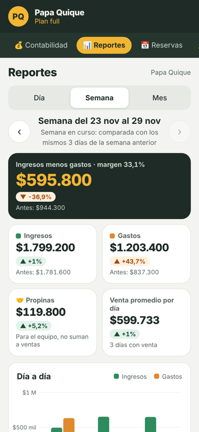
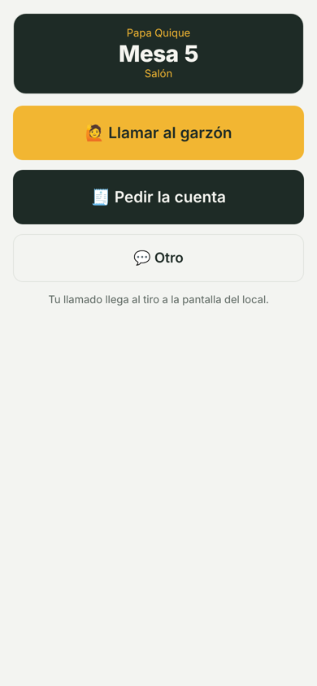

# ☕ Cafetería ByM

Software de gestión para cafeterías, **multi-cliente** y vendido por **planes**. Está programado **por islas**: cada módulo funciona aislado y se activa según el plan que contrate cada cafetería.

> Estado: prototipo local con base SQLite y datos de prueba de 4 cafeterías.

<p>
  
  
  
  
  
  
</p>

## Islas (módulos)

| Isla | Qué hace | Requiere |
|---|---|---|
| **Contabilidad** | Ingresos por medio de pago, gastos por categoría, propinas y reparto por garzón | — |
| **Reportes** | Resumen diario, semanal y mensual, con comparación contra el periodo anterior | Contabilidad |
| **Reservas** | Mesas, agenda del día, ocupación y página pública para reservar | — |
| **Llamado a mesa** | QR por mesa: el comensal llama al garzón o pide la cuenta; cola en vivo | — |
| **Facturas** | Escaneo de facturas de proveedores, catálogo de productos con costo, alertas de alza y registro automático del gasto | Contabilidad |

Además incluye un **dashboard de administración interna** (`/admin`) para el equipo que vende el software: MRR, clientes por plan, matriz de qué cliente tiene cada isla, cambio de plan o estado, y add-ons o bloqueos por cliente.

## Planes (precios referenciales, CLP + IVA)

| Plan | Mensual | Islas |
|---|---|---|
| Emprende | $14.990 | Contabilidad, Reportes |
| Local | $29.990 | + Reservas |
| Pro | $49.990 | Todas |
| Cadena | $99.990 (2 locales) + $39.990 por local extra | Todas + consolidado |

Pago anual: 12 meses al precio de 10. Prueba gratis de 14 días. Detalle completo, add-ons, límites e implementación en [`docs/planes.md`](docs/planes.md).

## Cómo correrlo

Requisitos: [Bun](https://bun.sh) 1.1 o superior.

```bash
bun install
bun run seed          # crea data/cafeteria.db con datos de prueba
bun server/index.ts   # API en http://localhost:3001
bunx vite             # web en http://localhost:5173
```

| Ruta | Qué es |
|---|---|
| `/` | Elegir cliente de prueba |
| `/c/papa-kike` | Sistema del local (solo muestra las islas de su plan) |
| `/admin` | Administración interna |
| `/p/papa-kike/mesa/5` | Página pública del QR de una mesa |
| `/p/papa-kike/reservar` | Página pública para reservar |

Clientes de prueba: **Papa Kike** (Pro, piloto), **Café Los Andes** (Local), **La Tetera** (Local + add-on Llamado) y **Barista del Sur** (Emprende).

## Arquitectura

```
shared/modules.ts          catálogo de islas y dependencias
server/
  core/                    núcleo: DB SQLite, router, tenancy, planes
  modules/<isla>/          backend de cada isla (tablas, datos de prueba, rutas)
  admin/                   API de administración interna
web/src/
  core/                    shell de la app, cliente HTTP
  modules/<isla>/          pantallas de cada isla
  admin/                   dashboard interno
docs/planes.md             propuesta de planes y precios
CONTRATOS.md               cómo construir una isla nueva
```

- **Islas activas de un cliente** = islas de su plan **+ add-ons − bloqueos**, y solo si el cliente está activo. Una isla sin sus requisitos queda apagada.
- El núcleo monta cada isla en `/api/m/<isla>` y responde **403** si el cliente no la tiene. La web solo muestra en el menú las islas activas.
- Una isla nunca importa código de otra. Si necesita datos de otra, los lee en modo solo lectura.
- El cliente activo viaja en el header `x-tenant` (slug).

Para agregar una isla nueva: ver [`CONTRATOS.md`](CONTRATOS.md).

## Stack

Bun · bun:sqlite · React 19 · Vite · TypeScript · React Router. Sin librerías de gráficos ni de QR (generador QR propio).

## Pendiente

- Login y permisos (hoy la administración está abierta).
- OCR real para facturas: reemplazar `extraerFactura()` en `server/modules/facturas/`.
- Validar precios contra la competencia.
- Islas futuras: inventario, fidelización, delivery, boleta electrónica SII, turnos.

## Publicar la demo (Render, gratis)

El servidor Bun sirve la API y también el frontend compilado (`dist/`), así que es un solo servicio.
Cada arranque recrea la base con los datos de prueba.

1. En [render.com](https://render.com) entra con GitHub.
2. **New → Blueprint**, elige el repo `cafeteria-bym`. Render lee `render.yaml` y crea el servicio `cafeteria-bym-demo` (plan Free, Docker).
3. Al terminar el deploy queda en `https://cafeteria-bym-demo.onrender.com` (o el nombre que asigne Render).

En el plan Free el servicio se duerme tras 15 min sin visitas; la primera carga después tarda ~1 minuto.
Para probar la imagen localmente: `docker build -t cafe . && docker run -p 3001:3001 cafe`.
